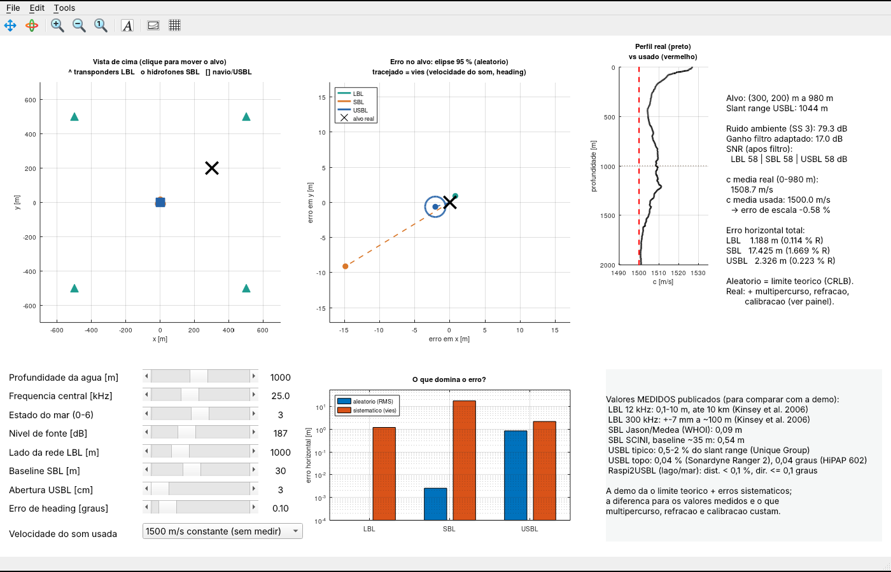

# 1.º trabalho de PERSE — Posicionamento acústico subaquático (USBL, SBL, LBL)

Estudo dos três sistemas clássicos de posicionamento acústico subaquático:
princípios de funcionamento, métodos de medida, modelos de sensores,
características dos transdutores, arquitetura dos sistemas, técnicas de
processamento e aplicações, com exemplos didáticos em MATLAB.

## Organização

```text
trabalho-1-posicionamento-acustico/
├── README.md
├── apresentacao/              slides v0 (DESATUALIZADOS, vão ser alterados)
├── docs/
│   ├── base-tecnica.md        documento técnico completo (com referências)
│   └── img/                   diagrama da arquitetura USBL e captura da demo
└── matlab/
    ├── README.md              descrição de cada script, parâmetros e fontes
    ├── demo_interativa.m      demo principal (interface gráfica)
    ├── demo1..demo6_*.m       exemplos de um conceito cada
    ├── correr_tudo.m          corre demo1..demo6 e guarda as figuras
    ├── *.m                    funções de apoio (modelo, Mackenzie, Thorp, ...)
    └── dados/                 perfis Argo reais (temperatura, salinidade)
```

## Documento técnico

[`docs/base-tecnica.md`](docs/base-tecnica.md) cobre, por esta ordem:

1. Física do canal: velocidade do som (Mackenzie), refração, absorção (Thorp), ruído
2. Transdutores: modelo Butterworth–Van Dyke, diretividade, nível de fonte, sensibilidade
3. Orçamento do enlace (equação do sonar), validado com especificações reais
4. Medidas de base: TWTT, OWTT, TDOA, fase, filtro adaptado, limite de Cramér–Rao
5. LBL · 6. SBL · 7. USBL (arquitetura, modelo de medida, geometria, calibração, erros)
8. Processamento e fusão com INS/DVL (filtro de Kalman, rejeição de outliers)
9. Comparação · 10. Aplicações · 11. Exemplos MATLAB · 12. Perguntas prováveis

## Apresentação

Os slides em [`apresentacao/`](apresentacao/) são uma **versão antiga e
desatualizada** (v0), que vai ser alterada para refletir o documento técnico
atual.

## Demo interativa



No MATLAB, dentro de `matlab/`:

```matlab
demo_interativa
```

Clicar na vista de cima move o alvo; os sliders mudam profundidade,
frequência, estado do mar, nível de fonte, geometria das redes e erro de
heading; o menu escolhe a velocidade do som que o sistema usa. O perfil
verdadeiro é sempre um perfil Argo real medido a oeste de Lisboa
(20/07/2025).

Também corre em GNU Octave com o toolkit gráfico `qt`.

## Dados e fontes

- Perfis de temperatura e salinidade: bóias Argo 6901998 e 7901143,
  julho–agosto de 2025, 38,7–39,7°N, 10,6–12,9°W
  ([Argo, doi:10.17882/42182](https://doi.org/10.17882/42182)), obtidos do
  ERDDAP do Ifremer.
- Os restantes parâmetros (ruído ambiente, nível de fonte, erro de heading)
  vêm de fontes publicadas, listadas em [`matlab/README.md`](matlab/README.md)
  e nas referências do documento técnico.

## Limitações conhecidas

A demo calcula o limite teórico do erro aleatório (Cramér–Rao) e os erros
sistemáticos de velocidade do som e de heading. Não modela multipercurso,
refração, erro do GNSS nem erros de calibração; o painel da demo mostra os
valores medidos publicados para comparação.
