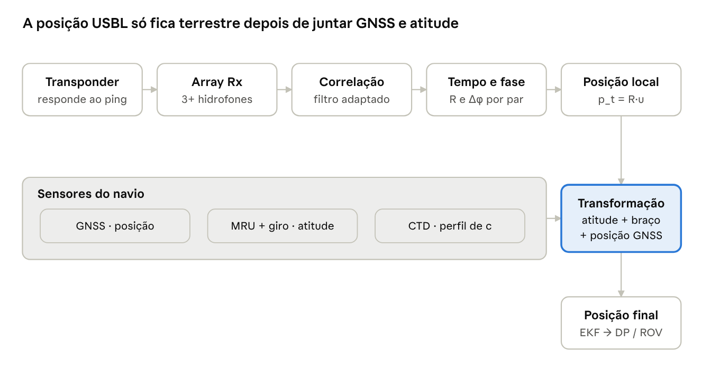

# PERSE — Posicionamento acústico subaquático (LBL, SBL, USBL): base técnica

26 de novembro de 2026

## Âmbito

Os três sistemas (LBL, SBL e USBL) medem **tempos de propagação de som** e convertem-nos em posição; diferem apenas na **baseline** — a distância entre os elementos de referência — e por isso na geometria, na precisão e na logística. Este documento é a base técnica do trabalho: cada secção responde a um ponto do enunciado (princípio de funcionamento, métodos de medida, modelos de sensores, características dos transdutores, arquitetura, processamento, aplicações) e liga-se a um exemplo em MATLAB.

| Ponto do enunciado | Secções |
| --- | --- |
| Princípios de funcionamento | Física do canal, Medidas de base |
| Métodos de medida | Medidas de base, LBL, SBL, USBL |
| Modelos de sensores e transdutores | Transdutores, Orçamento do enlace |
| Arquitetura dos sistemas | LBL, SBL, USBL |
| Técnicas de processamento | Medidas de base, Processamento e fusão |
| Utilização e aplicações | Comparação, Aplicações |
| Exemplos didáticos | Exemplos MATLAB |

**Notação.** c = velocidade do som \[m/s\]; r = distância oblíqua (*slant range*) \[m\]; TWTT = tempo de ida e volta; OWTT = tempo de ida; TDOA = diferença de tempos de chegada; f = frequência; λ = c/f; d = espaçamento entre elementos; p = posição do alvo; bᵢ = posição da referência i.

## 1. Física do canal acústico

O canal impõe três limites a qualquer sistema: a **velocidade do som** fixa a conversão tempo→distância, a **absorção** fixa o alcance para cada frequência, e a **refração e o multipercurso** distorcem o percurso medido.

### 1.1 Velocidade do som

A velocidade depende da temperatura T, da salinidade S e da profundidade D. A equação de 9 termos de [Mackenzie (1981)](https://doi.org/10.1121/1.386920) é válida para 2–30 °C, 25–40 ‰ e 0–8000 m ([NPL](https://resource.npl.co.uk/acoustics/techguides/soundseawater/underlying-phys.html)):

```math
c = 1448.96 + 4.591T - 5.304\times10^{-2}T^2 + 2.374\times10^{-4}T^3 + 1.340(S-35) + 1.630\times10^{-2}D + 1.675\times10^{-7}D^2 - 1.025\times10^{-2}T(S-35) - 7.139\times10^{-13}TD^3
```

O erro de distância é proporcional ao erro de velocidade: Δr = r · Δc / c. Assumir 1500 m/s quando a média real é 1490 m/s dá 6,7 m de erro a 1000 m. Na prática mede-se o perfil (SVP) com uma sonda CTD ou um velímetro e usa-se a velocidade média harmónica ao longo do percurso.

**Dados reais ao largo de Portugal.** Foram usados cinco perfis de temperatura e salinidade medidos por bóias Argo a oeste de Lisboa em julho–agosto de 2025 (38,7–39,7°N, 10,6–12,9°W; [Argo, doi:10.17882/42182](https://doi.org/10.17882/42182)), com c calculado pela equação de Mackenzie. O perfil de referência é o da bóia 6901998 a 20/07/2025, em modo *delayed* (com controlo de qualidade), 593 níveis até 1998 dbar; vê-se a Água Mediterrânica a 1000–1300 m (salinidade ≈ 36).

| Profundidade da coluna | c média real (5 perfis) | Viés se assumir 1500 m/s | Dispersão entre perfis (desvio padrão) |
| --- | --- | --- | --- |
| 0–500 m | 1506–1510 m/s | ≈ +8 m/s (0,53 %) | 1,7 m/s |
| 0–1000 m | 1507–1509 m/s | ≈ +8 m/s (0,54 %) | 0,5 m/s |
| 0–1950 m | 1507–1509 m/s | ≈ +7,5 m/s (0,50 %) | 0,9 m/s |

Leitura: não medir o perfil e assumir 1500 m/s custa ≈ 0,5 % em todas as distâncias (5 m a 1 km); um perfil de outro dia ou de outra bóia próxima reduz o erro para ≈ 0,03–0,1 %. A profundidade foi aproximada pela pressão (1 dbar ≈ 1 m, diferença < 1 %).

### 1.2 Refração

Num meio estratificado o raio obedece à lei de Snell, cos θ / c(z) = constante (θ medido à horizontal): o raio curva para a zona de menor velocidade. Para percursos quase verticais o efeito é pequeno; para percursos oblíquos e longos o ângulo de chegada deixa de apontar para o alvo, o que afeta sobretudo o USBL, que mede ângulos. Os sistemas comerciais corrigem com *ray tracing* sobre o SVP medido.

### 1.3 Perdas de propagação

A perda de transmissão num sentido soma o espalhamento geométrico e a absorção:

```math
TL(r,f) = k\cdot 10\log_{10}(r) + \alpha(f)\, r\cdot 10^{-3} \quad [\mathrm{dB}],\; r\ \mathrm{em\ m}
```

com k = 2 para espalhamento esférico (água profunda, percursos curtos), k = 1 para cilíndrico (guia de onda em água pouco profunda), e k = 1,5 como compromisso prático ([ns-3, modelo de Thorp](https://www.nsnam.org/docs/doxygen-bak/dd/d36/uan-prop-model-thorp_8cc_source.html)).

A absorção α(f) vem de relaxações químicas (ácido bórico e sulfato de magnésio) e da viscosidade ([Francois & Garrison, 1982](https://data-ww3.ifremer.fr/BIB/Francois_Garrison_JASA1982.pdf)). A aproximação de Thorp, com f em kHz e α em dB/km, é adequada entre 100 Hz e 100 kHz ([Kibblewhite & Hampton, 1980](https://data-ww3.ifremer.fr/BIB/Kibblewhite_Hampton_JASA1980.pdf)):

```math
\alpha(f) = \frac{0.11 f^2}{1+f^2} + \frac{44 f^2}{4100+f^2} + 2.75\times10^{-4} f^2 + 0.003
```

| Frequência | α (Thorp) | Absorção em 1 km | Absorção em 5 km |
| --- | --- | --- | --- |
| 10 kHz | ≈ 1,2 dB/km | 1,2 dB | 6 dB |
| 25 kHz | ≈ 6,1 dB/km | 6,1 dB | 31 dB |
| 100 kHz | ≈ 34 dB/km | 34 dB | 170 dB |

É esta tabela que explica as bandas de operação: a 100 kHz um enlace de 5 km é impossível, enquanto a 10–30 kHz é viável. Para precisão melhor usa-se a fórmula de Francois-Garrison, válida de 200 Hz a 1 MHz.

### 1.4 Ruído ambiente e multipercurso

Entre cerca de 400 Hz e 50 kHz o ruído ambiente é dominado pelo vento à superfície, e o tráfego marítimo domina abaixo de 400 Hz ([Hildebrand et al., 2021](https://www.cetus.ucsd.edu/docs/publications/HildebrandJASA2021.pdf)); as curvas de Wenz (1962) são a referência clássica. Num navio, o ruído próprio (hélices, propulsores de DP) é muitas vezes o termo dominante para o transceiver.

Reflexões na superfície, no fundo e no casco criam cópias atrasadas do sinal. O primeiro pico do filtro adaptado é normalmente o percurso direto; os seguintes são multipercurso e têm de ser rejeitados. Refração e reflexões afetam mais o USBL do que o LBL ([Wikipedia](https://en.wikipedia.org/wiki/Underwater_acoustic_positioning_system)).

## 2. Transdutores: modelos e características

Os transdutores destes sistemas são quase sempre **cerâmicas piezoelétricas (PZT)** que funcionam perto da ressonância; o mesmo elemento pode emitir (projetor) e receber (hidrofone). A cerâmica PZT é o material mais comum pela sensibilidade, estabilidade e resposta em frequência ([IEEE TechNav](https://technav.ieee.org/topic/hydrophone/)).

### 2.1 Modelo elétrico equivalente (Butterworth–Van Dyke)

Perto da ressonância o transdutor comporta-se como um ramo **mocional** Rₘ–Lₘ–Cₘ em série (massa → Lₘ, elasticidade → Cₘ, radiação e perdas → Rₘ) em paralelo com a capacidade estática C₀ dos elétrodos ([modelo BVD](https://arxiv.org/pdf/2103.00471)). A potência dissipada em Rₘ que corresponde à radiação é a potência acústica emitida.

```math
Z(\omega) = \left[\, j\omega C_0 + \frac{1}{R_m + j\omega L_m + \frac{1}{j\omega C_m}} \right]^{-1}
```

```math
f_s = \frac{1}{2\pi\sqrt{L_m C_m}}, \qquad f_p = f_s\sqrt{1 + \frac{C_m}{C_0}}, \qquad Q_m = \frac{2\pi f_s L_m}{R_m}, \qquad k_{\mathrm{eff}}^2 \approx \frac{f_p^2 - f_s^2}{f_p^2}
```

- **fₛ (ressonância série)**: impedância mínima, máxima eficiência como projetor.
- **fₚ (antirressonância)**: impedância máxima.
- **Qₘ e largura de banda**: B ≈ fₛ / Qₘ. Um Q alto dá muito nível numa banda estreita; sinais *wideband* (chirps) precisam de Q baixo, o que se obtém com camadas de adaptação e uma bobina de sintonia em paralelo com C₀ ([Stansfield](https://www.ioa.org.uk/system/files/proceedings/d_stansfield_broad-band_transmitter_system_design.pdf)).
- **k\_eff**: coeficiente de acoplamento eletromecânico; mede a fração de energia convertida e limita a largura de banda alcançável.

### 2.2 Diretividade

Um transdutor de face circular de diâmetro D comporta-se aproximadamente como um pistão num ecrã ([boat-fundamentals](https://boat-fundamentals.readthedocs.io/en/latest/acoustics/SL_2_beampattern.html)):

```math
b(\theta) = \left|\frac{2 J_1(ka\sin\theta)}{ka\sin\theta}\right|, \quad k = \frac{2\pi}{\lambda},\; a = \frac{D}{2}; \qquad DI \approx 10\log_{10}\big((ka)^2\big)\ \mathrm{dB}\ (ka \gg 1)
```

A abertura a −3 dB é aproximadamente 59°·λ/D. Consequência prática: um transponder num ROV precisa de ser quase omnidirecional (D pequeno face a λ), enquanto o transceiver USBL pode formar feixes estreitos com um array grande — é o caso dos arrays planares com formatação eletrónica de feixe do HiPAP 602 ([Kongsberg](https://www.kongsberg.com/globalassets/discovery/commerce/navigation--positioning/hipap-602/476666a-hipap-602-datasheet.pdf)).

### 2.3 Grandezas de emissão e receção

| Grandeza | Definição | Valores típicos |
| --- | --- | --- |
| Nível de fonte SL | SL = 170,8 + 10 log Pₑ + η + DI \[dB re 1 µPa @ 1 m\], Pₑ em W, η eficiência em dB ([Kumar & Ramesh](https://www.ioa.org.uk/system/files/publications/MA%20KUMAR%20R%20RAMESH%20COMPUTATIONS%20OF%20ELECTRO-ACOUSTIC%20EFFICIENCY%20OF%20UNDERWATER%20TONPILZ%20TRANSDUCER.pdf)) | 187–199 dB em transponders MF ([Sonardyne](https://sonardyne.com/engineered-for/auv/page/2)) |
| Resposta de emissão (TVR) | pressão a 1 m por volt aplicado, dB re 1 µPa/V @ 1 m ([patente US9308554](https://image-ppubs.uspto.gov/dirsearch-public/print/downloadPdf/9308554)) | 130–145 dB em hidrofones de referência ([Teledyne RESON](https://issuu.com/reson/docs/hydrophones_transducers_accessories)) |
| Sensibilidade de receção (RVS) | volts de saída por µPa, dB re 1 V/µPa | −170 a −200 dB em hidrofones de investigação ([IEEE TechNav](https://technav.ieee.org/topic/hydrophone/)); −206 dB no TC4040 ([Teledyne](https://www.teledynemarine.com/en-us/products/SiteAssets/RESON/TC4040%20product%20leaflet.pdf)) |

Exemplo de receção: um sinal de 120 dB re 1 µPa num hidrofone com RVS = −200 dB re 1 V/µPa produz −80 dB re 1 V, ou seja 100 µV — daí a necessidade de pré-amplificador de baixo ruído junto ao elemento.

### 2.4 Sensores auxiliares (fazem parte da medida)

- **Sensor de pressão** (profundidade): resolve a componente vertical, que a geometria acústica determina mal.
- **CTD ou velímetro**: perfil de c para converter tempos em distâncias e para *ray tracing*.
- **MRU / giroscópio / AHRS**: roll, pitch e heading do navio para rodar medidas USBL e SBL.
- **GNSS**: posição do navio, que transforma posições relativas em absolutas.
- **INS + DVL** no veículo: navegação entre pings (secção 8).

## 3. Orçamento do enlace: equação do sonar

O alcance de um sistema de posicionamento resulta de um balanço em dB: o sinal tem de chegar ao recetor acima do ruído com margem suficiente para o detetor. Como o transponder **responde** (não há eco num alvo), cada sentido é um enlace **passivo** independente, sem termo de *target strength* ([MathWorks](https://www.mathworks.com/help/phased/ug/sonar-equation.html)):

```math
SNR_{\mathrm{out}} = SL - TL(r,f) - (NL - DI) + 10\log_{10}(BT) \;\ge\; DT
```

- SL: nível de fonte do emissor (secção 2.3).
- TL: perda de transmissão num sentido (secção 1.3).
- NL: ruído na banda do recetor, NL = NSL + 10 log B, com NSL o nível espectral em dB re 1 µPa²/Hz ([DTIC, introdução às equações do sonar](https://apps.dtic.mil/sti/tr/pdf/ADA030034.pdf)).
- DI: índice de diretividade do recetor.
- 10 log(BT): ganho do filtro adaptado (secção 4.3).
- DT: limiar de deteção para a probabilidade de deteção e de falso alarme desejadas.

O enlace mais fraco decide: um transponder alimentado a bateria com SL menor, ou um transceiver num navio ruidoso, limita o sistema inteiro.

### Exemplo numérico

Valores com fonte: SL = 187 dB re 1 µPa @ 1 m (transponder MF omnidirecional de alta potência, [Sonardyne](https://sonardyne.com/engineered-for/auv/page/2)); ruído ambiente medido, ajuste às curvas de Urick/Knudsen ([Kurahashi & Gratta](https://arxiv.org/pdf/0712.1833)): NSL(f, SS) = 94,5 − (50/3)·log₁₀ f\[Hz\] + 30·log₁₀(SS + 1) dB re 1 µPa²/Hz (curvas médias de Urick para 1–40 kHz; os autores validaram-no com hidrofones no mar até ≈ 25 kHz, acima disso o ruído medido cai mais depressa, ou seja, o modelo é conservador). Com estado do mar 3 isto dá 39 dB a 25 kHz. Parâmetros de projeto: B = 10 kHz, chirp de 5 ms (ganho 17 dB), recetor omnidirecional, espalhamento esférico. SNR após o filtro adaptado, em dB:

| Frequência central | α (Thorp) | NSL (SS 3) | 1 km | 3 km | 6 km | 10 km | Alcance (SNR ≥ 10 dB) |
| --- | --- | --- | --- | --- | --- | --- | --- |
| 15 kHz | 2,5 dB/km | 43 dB | 59 | 44 | 31 | 16 | ≈ 12 km |
| 25 kHz | 6,1 dB/km | 39 dB | 59 | 37 | 13 | −16 | ≈ 6,3 km |
| 50 kHz | 17,5 dB/km | 34 dB | 52 | 8 | −51 | −125 | ≈ 2,9 km |

**Validação com especificações reais.** O modelo prevê ≈ 6,3 km a 25 kHz e ≈ 12 km a 15 kHz; a Sonardyne especifica a banda MF (20–34 kHz) até 7000 m e a banda LMF (14–19,5 kHz) para alvos para lá de 11 km ([Sonardyne](https://www.sonardyne.com/technology/sensor-tracking/)). Com mar calmo (SS 0) o alcance a 25 kHz sobe para ≈ 8,8 km e com SS 6 desce para ≈ 5,4 km. O ruído próprio do navio não está incluído; quando domina, reduz estes alcances. O preço de descer na frequência é λ maior, transdutores maiores e menos largura de banda, logo pior resolução temporal e angular.

O script `demo5_orcamento_enlace.m` reproduz esta tabela e traça SNR em função da distância.

## 4. Medidas de base e processamento de sinal

Todos os sistemas combinam três observáveis — **tempo de voo**, **diferença de tempos** e **diferença de fase** — extraídas do sinal recebido por um filtro adaptado. A precisão temporal é limitada pela largura de banda e pelo SNR.

### 4.1 Tempo de voo

**Ida e volta (TWTT).** O interrogador emite em t₀; o transponder responde após um atraso fixo e calibrado t\_ta; a resposta chega em t₁:

```math
r = \frac{\bar{c}\,(t_1 - t_0 - t_{ta})}{2}
```

Não exige relógios sincronizados, mas cada medida ocupa o canal durante 2r/c (1,3 s a 1000 m), o que limita a taxa de atualização e o número de veículos servidos.

**Só ida (OWTT).** Com relógios estáveis e sincronizados no emissor e nos recetores, o instante de emissão vai codificado na mensagem e cada recetor mede r = c·(t\_rx − t\_tx). Qualquer número de veículos pode ouvir o mesmo farol em simultâneo; foi demonstrado com o WHOI Micro-Modem e relógios estáveis ([Eustice, Singh & Whitcomb, 2011](https://doi.org/10.1002/rob.20365)). A deriva do relógio entra diretamente na distância: 1 µs de erro = 1,5 mm.

**Diferença de tempos (TDOA).** Quando vários recetores ouvem o mesmo sinal, Δtᵢⱼ = (rᵢ − rⱼ)/c não depende do instante de emissão. Cada TDOA define um hiperboloide; é a observável natural do SBL e dos sistemas passivos.

### 4.2 Ângulo de chegada por fase

Para uma onda plana com direção unitária u e dois elementos separados pelo vetor d⃗, a diferença de percurso é d⃗·u e a diferença de fase à frequência f é:

```math
\Delta\varphi = \frac{2\pi}{\lambda}\,\vec{d}\cdot\mathbf{u} \pmod{2\pi} \qquad\Rightarrow\qquad \sin\theta = \frac{\lambda\,\Delta\varphi}{2\pi d}
```

A fase só é medida módulo 2π. Com d ≤ λ/2 não há ambiguidade em ±90°, mas a sensibilidade é baixa (secção 7.3).

### 4.3 Sinal, filtro adaptado e resolução

Em vez de um tom, emite-se um sinal de banda larga s(t) — chirp ou sequência pseudoaleatória. O recetor correlaciona com a réplica:

```math
y(t) = \int x(\tau)\, s^{*}(\tau - t)\, d\tau, \qquad G = 10\log_{10}(BT)\ \mathrm{dB}, \qquad \delta r \approx \frac{c}{2B}
```

O pico de |y| dá o tempo de chegada; a fase de y no pico dá a fase para o ângulo. Com B = 10 kHz e T = 5 ms o ganho é 17 dB e a resolução em distância 7,5 cm. A Sonardyne refere que os sinais *wideband* permitiram obter na banda MF a precisão de distância que antes exigia frequências extra-altas ([Hydro International](https://www.hydro-international.com/content/article/wideband-signals-the-future-for-acoustic-positioning)). Códigos diferentes por transponder permitem ouvir vários ao mesmo tempo.

**Limite teórico (Cramér–Rao).** Para qualquer estimador não enviesado do atraso ([Hostetter, sdr](https://mhostetter.github.io/sdr/latest/api/sdr.toa_crlb)):

```math
\sigma_\tau \ge \frac{1}{\pi\sqrt{8}\,\beta_{\mathrm{rms}}\sqrt{E/N_0}}, \qquad \beta_{\mathrm{rms}} = B/\sqrt{12}\ \text{(espectro retangular)}
```

Exemplo: B = 10 kHz e E/N₀ = 20 dB dão σ\_τ ≈ 3,9 µs, ou seja cerca de 3 mm em distância (TWTT). Na prática a precisão fica muito pior por causa de c, multipercurso, movimento e atrasos internos — o limite mostra que o problema raramente é o hardware de medida de tempo.

### 4.4 Efeito de Doppler e movimento

Um veículo a 2 m/s comprime o sinal num fator v/c ≈ 1,3×10⁻³ (33 Hz a 25 kHz). Chirps toleram pequenos desvios de Doppler mas acoplam-nos a um erro de tempo; sistemas mais elaborados estimam o Doppler e usam-no como medida de velocidade. O veículo também se desloca entre a interrogação e a resposta, o que tem de ser compensado na fusão (secção 8).

## 5. LBL — Long Baseline

O LBL posiciona um veículo por **trilateração** a partir de distâncias a 3 ou mais transponders fixos no fundo, afastados de centenas de metros a quilómetros. Como a baseline é da ordem da distância ao alvo, um erro de distância dá aproximadamente o mesmo erro de posição, e a precisão não depende da profundidade ([Wikipedia LBL](https://en.wikipedia.org/wiki/Long_baseline_acoustic_positioning_system)).

### 5.1 Arquitetura e ciclo de operação

1. **Instalação**: tipicamente 4 transponders, à volta da área de trabalho, presos a uma âncora com flutuador e libertador acústico para recuperação.
2. **Calibração da rede**: as posições bᵢ têm de ser conhecidas. Mede-se a distância entre pares de transponders (autocalibração acústica, dá a geometria relativa) e georreferencia-se a rede a partir do navio com GNSS, navegando à volta de cada transponder e resolvendo a sua posição por mínimos quadrados.
3. **Interrogação**: o veículo emite um ping numa frequência comum; cada transponder responde numa frequência ou código próprio, após um atraso fixo.
4. **Cálculo**: TWTT → distâncias → posição, a bordo (AUV) ou à superfície através do umbilical (ROV), habitualmente com a profundidade do sensor de pressão.

Há dois regimes típicos ([Kinsey, Eustice & Whitcomb, 2006](https://whoi.edu/cms/files/jkinsey-2006a_20090.pdf)):

| Regime | Alcance | Precisão | Atualização |
| --- | --- | --- | --- |
| 12 kHz (oceano profundo) | até ≈ 10 km | 0,1–10 m, depende da distância | lenta: períodos até 20 s ou mais |
| 300 kHz (curto alcance) | ≈ 100 m | ≈ ±7 mm | 1–10 Hz |

A taxa é limitada pela física: cada ciclo espera pelo eco mais distante, e num LBL clássico interrogação-resposta só um veículo é servido por ciclo ([Eustice et al., 2006](https://robots.engin.umich.edu/publications/reustice-2006a.pdf)).

### 5.2 Modelo de medida

```math
r_i = \lVert \mathbf{p} - \mathbf{b}_i \rVert + \delta_i + v_i, \qquad i = 1,\dots,N
```

com δᵢ os erros sistemáticos (c errada, atraso interno do transponder, erro de calibração de bᵢ) e vᵢ o ruído aleatório.

### 5.3 Solução

**Forma fechada (linearizada).** Subtraindo a equação ao quadrado da referência 1 às restantes eliminam-se os termos quadráticos em p e obtém-se um sistema linear A·p = b, útil como estimativa inicial ([Alcocer, Oliveira & Pascoal, IST](https://isr.tecnico.ulisboa.pt/wp-content/uploads/2015/05/1502_ECUA06_LEGAL.pdf)):

```math
2(\mathbf{b}_i - \mathbf{b}_1)^{\mathsf T}\mathbf{p} = r_1^2 - r_i^2 + \lVert\mathbf{b}_i\rVert^2 - \lVert\mathbf{b}_1\rVert^2, \qquad i = 2,\dots,N
```

**Mínimos quadrados não lineares (Gauss–Newton).** Itera-se a partir da estimativa anterior:

```math
\mathbf{J}_i = \frac{(\mathbf{p}-\mathbf{b}_i)^{\mathsf T}}{\lVert\mathbf{p}-\mathbf{b}_i\rVert}, \qquad \Delta\mathbf{p} = (\mathbf{J}^{\mathsf T}\mathbf{W}\mathbf{J})^{-1}\mathbf{J}^{\mathsf T}\mathbf{W}\,(\mathbf{r} - \boldsymbol{\rho}(\mathbf{p}))
```

W pondera cada distância pelo inverso da sua variância. Com profundidade conhecida, z sai do vetor de estado e o problema passa a 2D.

### 5.4 Geometria (DOP)

Com ruído de distância σ\_r igual em todas as referências, a covariância da posição é σ\_r²·(JᵀJ)⁻¹ e o fator de geometria é:

```math
\mathrm{HDOP} = \sqrt{\left[(\mathbf{J}^{\mathsf T}\mathbf{J})^{-1}\right]_{xx} + \left[(\mathbf{J}^{\mathsf T}\mathbf{J})^{-1}\right]_{yy}}, \qquad \sigma_{h} \approx \mathrm{HDOP}\cdot\sigma_r
```

Dentro do quadrilátero de transponders o HDOP é ≈ 1 e degrada-se fora dele. A componente vertical é mal determinada porque os transponders estão todos aproximadamente ao mesmo nível — daí o sensor de pressão. Na simulação `demo2_lbl.m` (fundo a 500 m, rede de 1000 m, σ\_r ≈ 0,1 m): erro horizontal RMS 0,10 m; erro vertical 0,66 m só com acústica e 0,05 m com o sensor de pressão.

### 5.5 Fontes de erro

- Velocidade do som média errada: erro de escala comum a todas as distâncias.
- Erro de calibração da rede: erro fixo (viés) em toda a área.
- Movimento do veículo durante o ciclo: as distâncias referem-se a instantes diferentes.
- Multipercurso e outliers: uma resposta refletida dá uma distância longa demais; sem rejeição, um único outlier degrada muito a solução filtrada ([Alcocer et al.](https://isr.tecnico.ulisboa.pt/wp-content/uploads/2015/05/1502_ECUA06_LEGAL.pdf)).

### 5.6 Variante: GIB (LBL invertido à superfície)

No sistema GIB, quatro boias à superfície com DGPS e hidrofones submersos recebem um *pinger* sincronizado no alvo; os tempos de chegada (só ida) vão por rádio para uma estação central que calcula a posição, e o *pinger* codifica a profundidade no intervalo entre dois impulsos ([Alcocer, Oliveira & Pascoal, 2006](https://isr.tecnico.ulisboa.pt/wp-content/uploads/2015/05/1502_ECUA06_LEGAL.pdf)). Evita a instalação e calibração no fundo, com precisão semelhante à do LBL ([Wikipedia](https://en.wikipedia.org/wiki/Underwater_acoustic_positioning_system)).

## 6. SBL — Short Baseline

O SBL leva a baseline para o navio: 3 ou mais transdutores, separados por dezenas de metros, medem tempos de chegada da resposta do alvo. Com o alvo longe face à baseline, o SBL comporta-se como um USBL com espaçamento muito maior — e por isso a precisão melhora com o espaçamento e piora com a distância ([Wikipedia SBL](https://en.wikipedia.org/wiki/Short_baseline_acoustic_positioning_system)).

### 6.1 Arquitetura

- Transdutores instalados nas extremidades do casco, num poste pela borda, numa doca ou no gelo, ligados por cabo a uma unidade central; a baseline fica limitada ao tamanho do navio ([Paull et al., 2014](https://doi.org/10.1109/JOE.2013.2278891)).
- Um transdutor (mestre) interroga; todos recebem a resposta do transponder.
- As posições são relativas ao navio: para coordenadas terrestres juntam-se GNSS, agulha/giroscópio e sensor de atitude.

### 6.2 Modelo de medida

O mestre (elemento 1) mede TWTT, e os restantes medem o tempo desde a interrogação até à chegada da resposta:

```math
t_1 = \frac{2 r_1}{c} + t_{ta}, \qquad t_j = \frac{r_1 + r_j}{c} + t_{ta} \;\Rightarrow\; \Delta t_{j1} = t_j - t_1 = \frac{r_j - r_1}{c}
```

Com r₁ e as diferenças rⱼ − r₁ resolve-se a posição como no LBL (secção 5.3), com as referências bⱼ no referencial do navio.

### 6.3 Geometria: porque piora com a profundidade

Para um alvo a distância R ≫ L, a diferença de tempo entre dois hidrofones separados por L é Δt ≈ L·sin θ / c. O erro angular e o erro lateral são então:

```math
\sigma_\theta \approx \frac{c\,\sigma_{\Delta t}}{L\cos\theta}, \qquad \sigma_{\mathrm{lateral}} \approx R\,\sigma_\theta \approx \frac{R}{L}\cdot\frac{c\,\sigma_{\Delta t}}{\cos\theta}
```

A razão R/L é o fator de diluição. Com o mesmo erro de tempo, passar de L = 20 m para L = 50 m divide o erro por 2,5. O USBL obedece à mesma expressão com L ≈ λ/2 ≈ 3 cm, mas compensa o L minúsculo medindo a **fase** (sub-ciclo) em vez do tempo — a resolução de fase equivale a uma fração de 1/f (40 µs a 25 kHz).

### 6.4 Desempenho e exemplos

- Com espaçamento grande aproxima-se da precisão do LBL; no sistema SHARPS do Jason/Medea (WHOI), com transdutores no peso depressor Medea, foi reportada precisão de 0,09 m, independente da profundidade de operação ([Wikipedia SBL](https://en.wikipedia.org/wiki/Short_baseline_acoustic_positioning_system)).
- No ROV SCINI (Antártida) os transdutores ficam em triângulo equilátero de ≈ 35 m sobre o gelo, com precisão típica de 0,54 m.
- Histórico: em 1963 um SBL no USNS Mizar guiou o batiscafo Trieste na busca do USS Thresher.

### 6.5 Fontes de erro

As do LBL, mais: posição dos hidrofones no casco (levantamento dimensional), flexão do casco, atitude e heading do navio, e ruído do próprio navio junto aos hidrofones.

## 7. USBL — Ultra-Short Baseline

O USBL mede **distância** pelo tempo de voo e **direção** pela diferença de fase entre elementos de um único transceiver compacto (espaçamento da ordem de centímetros), e converte-as em posição terrestre com GNSS e atitude do navio. A precisão depende da **abertura do array** e do SNR, e o erro de posição cresce com a distância.

### 7.1 Arquitetura

- **Transceiver**: array de 3 ou mais hidrofones com espaçamento até ≈ 10 cm num poste sob o navio, mais um elemento emissor ([Wikipedia USBL](https://en.wikipedia.org/wiki/Ultra-short_baseline_acoustic_positioning_system)). Sistemas de topo usam arrays planares grandes com formação eletrónica de feixe: o HiPAP 602 tem 560 canais *wideband* e especifica 0,04° de precisão angular dentro de ±30° e alcance até 7000 m ([Kongsberg](https://www.kongsberg.com/globalassets/discovery/commerce/navigation--positioning/hipap-602/476666a-hipap-602-datasheet.pdf)).
- **Transponder/responder** no veículo, estrutura ou mergulhador.
- **Sensores do navio**: GNSS (posição), MRU (roll, pitch), giroscópio/AHRS (heading), CTD/velímetro (perfil de c).
- **Unidade de processamento** (*topside*): deteção, estimação de tempo e fase, transformação de coordenadas, filtragem, saída para o sistema de posicionamento dinâmico (DP) ou para o ROV.



A cadeia de sinal (em cima) dá uma posição relativa ao transceiver; só a transformação com atitude, braço e GNSS (secção 7.4) a torna terrestre, e é aí que entram a maior parte dos erros sistemáticos. O perfil de c serve também para converter tempos em distâncias.

### 7.2 Estimação da direção

Com dois pares ortogonais (eixos x e y do transceiver) obtêm-se os cossenos diretores:

```math
u_x = \frac{\lambda\,\Delta\varphi_x}{2\pi d}, \qquad u_y = \frac{\lambda\,\Delta\varphi_y}{2\pi d}, \qquad u_z = -\sqrt{1 - u_x^2 - u_y^2}, \qquad \mathbf{p}_t = R\,[u_x,\,u_y,\,u_z]^{\mathsf T}
```

**Precisão.** O erro de fase por elemento após o filtro adaptado é σ\_φ ≈ 1/√SNR\_out \[rad\]; na diferença de dois elementos soma-se em quadratura:

```math
\sigma_{u} \approx \frac{\lambda}{2\pi d}\sqrt{\frac{2}{\mathrm{SNR_{out}}}}
```

Com d = λ/2 e SNR\_out = 20 dB, σ\_u ≈ 0,045 — cerca de 2,6°, ou 2,6 % do *slant range*. É a ordem de grandeza que o `demo3_usbl.m` obtém com 3 elementos e um único ping (1,6 % a 0 dB por amostra, secção 11). Os 0,04° dos sistemas comerciais vêm de três fatores: **abertura** muito maior que λ/2 (o erro cai com 1/d), **muitos elementos** (média sobre N pares) e **sinais wideband** com SNR alto.

### 7.3 Ambiguidade de fase e a sua resolução

A fase é medida módulo 2π, por isso se d > λ/2 vários ângulos dão a mesma Δφ:

```math
\Delta\varphi_{\mathrm{med}} = \frac{2\pi d}{\lambda}\sin\theta - 2\pi k, \qquad k \in \mathbb{Z}
```

Há um compromisso: d pequeno é não ambíguo mas impreciso; d grande é preciso mas ambíguo. A solução padrão usa **elementos redundantes** a várias distâncias ([Scientific.Net](https://www.scientific.net/AMM.571-572.1059), [MDPI 2024](https://www.mdpi.com/2077-1312/12/10/1689/html)):

1. Um par curto (d₁ ≤ λ/2) dá uma estimativa grosseira sem ambiguidade, sin θ̂₁.
2. Um par longo (d₂ ≫ λ/2) dá Δφ₂ ambíguo; escolhe-se o inteiro k = round\[(2π d₂ sin θ̂₁/λ − Δφ₂) / 2π\].
3. A estimativa final usa o par longo, com precisão d₂/d₁ vezes melhor.

Funciona se o erro do passo 1 for menor que λ/(2d₂) em sin θ; senão escolhe-se o k errado e a posição “salta”. Com sinais *wideband* pode também usar-se o atraso entre elementos (correlação) como estimativa grosseira.

### 7.4 Transformação para coordenadas terrestres

A medida está no referencial do transceiver (t), que está montado no navio (b), que se move no referencial de navegação (n):

```math
\mathbf{p}^{n} = \mathbf{p}^{n}_{\mathrm{GNSS}} + \mathbf{R}^{n}_{b}(\phi,\theta,\psi)\left[\,\mathbf{l}^{b} + \mathbf{R}^{b}_{t}\,\mathbf{p}^{t}\,\right]
```

- Rⁿ\_b: rotação de atitude medida pelo MRU e giroscópio (roll φ, pitch θ, heading ψ), no instante de receção.
- lᵇ: braço (*lever arm*) da antena GNSS ao centro acústico do transceiver, medido em doca.
- Rᵇ\_t: desalinhamento de montagem do transceiver, estimado por calibração.

Um erro angular δ em qualquer destas rotações desloca a posição de ≈ R·δ (heading: ≈ distância horizontal × δψ). Num sistema de 0,5 %, 1° de erro de instalação leva o erro a ≈ 1,7 % do *slant range* ([Liu et al., 2023](https://reference-global.com/download/article/10.2478/pomr-2023-0028.pdf)); 1° de desalinhamento de heading pode exceder 1 % do *slant range* em erro horizontal ([MDPI 2025](https://mdpi.com/2077-1312/13/5/877)).

### 7.5 Calibração

Coloca-se um transponder no fundo numa posição desconhecida e navega-se o navio à volta e por cima dele (padrões em cruz e círculo). Como o transponder está parado, a diferença entre as posições calculadas em diferentes rumos só se explica pelos desalinhamentos; resolve-se por mínimos quadrados para a posição do transponder e os ângulos de montagem (roll, pitch, heading) e, nos métodos mais recentes, também erros de fase entre elementos ([MDPI 2025](https://mdpi.com/2077-1312/13/5/877)). A Kinsey et al. referem a calibração de alinhamento entre o transceiver e o GNSS do navio como requisito do USBL ([2006](https://whoi.edu/cms/files/jkinsey-2006a_20090.pdf)).

### 7.6 Desempenho

| Fonte | Valor |
| --- | --- |
| Valor típico de mercado | 0,5–2 % do *slant range* ([Unique Group](https://www.uniquegroup.com/media-centre/blog-articles/usbl-vs-lbl-systems/)) |
| Sonardyne Ranger 2, totalmente otimizado | 0,04 % do *slant range*, alvos até 11 km ([Sonardyne](https://www.sonardyne.com/technology/sensor-tracking/)) |
| Kongsberg HiPAP 602 | 0,04° em direção (±30°), até 7000 m ([Kongsberg](https://www.kongsberg.com/globalassets/discovery/commerce/navigation--positioning/hipap-602/476666a-hipap-602-datasheet.pdf)) |
| Raspi2USBL (baixo custo, investigação) | distância melhor que 0,1 %, direção ≤ 0,1°, até 1,3 km ([arXiv 2511.06998](https://arxiv.org/pdf/2511.06998v1)) |

Os valores de fabricante são especificações em condições ótimas (SNR 20 dB, sistema calibrado), não desempenho garantido no terreno.

### 7.7 Variantes

- **USBL invertido (iUSBL)**: o transceiver vai no AUV e o transponder no navio ou em terra; o veículo calcula a própria posição — usado em *docking* e *homing* ([Wikipedia USBL](https://en.wikipedia.org/wiki/Ultra-short_baseline_acoustic_positioning_system)).
- **OWTT-iUSBL**: com relógios atómicos de chip sincronizados por GPS, um farol emite a cada segundo e qualquer número de AUVs com array USBL obtém distância e direção passivamente ([Rypkema et al.](https://arxiv.org/pdf/2110.13825)).

## 8. Processamento e fusão de sensores

As posições acústicas são **lentas, ruidosas e com outliers**, mas não derivam; a navegação inercial com DVL é **rápida e suave**, mas deriva. Um filtro de Kalman junta as duas: a experiência do WHOI com o ROV Jason mostrou que um sistema híbrido Doppler + LBL segue melhor a trajetória do que qualquer um dos dois sozinho ([Whitcomb et al., 1998](https://web.mit.edu/deeparch/www/publications/papers/WhitcombEtAl1998.pdf)).

### 8.1 Dead reckoning com DVL/INS

O DVL mede a velocidade em relação ao fundo com precisão de 0,3 % ou melhor e até 5 Hz; um sistema GPS + DVL de 300 kHz + inercial reportou erro relativo de 0,4 % da distância percorrida numa missão de 5 horas ([Kinsey et al., 2006](https://whoi.edu/cms/files/jkinsey-2006a_20090.pdf)). O erro cresce com a distância percorrida, sobretudo por erro de heading e de alinhamento DVL–atitude.

### 8.2 Filtro de Kalman estendido (EKF)

Modelo mínimo em 2D, com estado posição e um viés lento de velocidade (corrente, erro de escala):

```math
\mathbf{x}_k = \begin{bmatrix} x \\ y \\ b_x \\ b_y \end{bmatrix}_k, \qquad \mathbf{x}_{k+1} = \mathbf{x}_k + \Delta t\begin{bmatrix} v^{\mathrm{DVL}}_{x} + b_x \\ v^{\mathrm{DVL}}_{y} + b_y \\ 0 \\ 0 \end{bmatrix} + \mathbf{w}_k
```

Predição a cada amostra de DVL (≈ 1–5 Hz). Atualização a cada distância acústica rᵢ (LBL, *tightly coupled*) ou a cada posição USBL (*loosely coupled*):

```math
h_i(\mathbf{x}) = \sqrt{(x - b_{i,x})^2 + (y - b_{i,y})^2 + (z - b_{i,z})^2}, \qquad \mathbf{H}_i = \frac{\partial h_i}{\partial \mathbf{x}}, \qquad \mathbf{K} = \mathbf{P}\mathbf{H}^{\mathsf T}(\mathbf{H}\mathbf{P}\mathbf{H}^{\mathsf T} + \sigma_r^2)^{-1}
```

Vantagens do acoplamento apertado: usa medidas mesmo quando só 1 ou 2 transponders respondem, e trata cada distância no seu próprio instante.

### 8.3 Rejeição de outliers

O multipercurso produz distâncias longas demais, e um único outlier pode degradar muito a solução filtrada ([Alcocer, Oliveira & Pascoal](https://isr.tecnico.ulisboa.pt/wp-content/uploads/2015/05/1502_ECUA06_LEGAL.pdf)). O teste habitual é a distância de Mahalanobis da inovação:

```math
d^2 = \frac{(r_i - h_i(\hat{\mathbf{x}}))^2}{\mathbf{H}_i\mathbf{P}\mathbf{H}_i^{\mathsf T} + \sigma_r^2} > \chi^2_{1,\,0.99} \approx 6.63 \;\Rightarrow\; \text{rejeitar}
```

Completam-no janelas temporais (só se aceitam respostas na janela esperada para a posição prevista) e testes de consistência entre transponders.

### 8.4 Compensação temporal

Num ciclo LBL a 1000 m passam mais de 1 s entre interrogação e respostas. Um veículo a 1 m/s anda 1 m nesse intervalo — mais do que o erro de medida. Cada medida tem de ser associada ao instante certo (o filtro propaga o estado até ao instante de receção), e no USBL a atitude do navio tem de ser a do instante de receção.

O `demo6_kalman_lbl_dvl.m` compara dead reckoning só com DVL, LBL ponto a ponto e EKF com rejeição de outliers.

## 9. Comparação e critérios de escolha

A escolha é um compromisso entre **geometria** (baseline grande = precisão) e **logística** (baseline no navio = mobilização rápida). O LBL ganha em precisão e estabilidade; o USBL em simplicidade; o SBL fica no meio e depende do tamanho do navio.

| Critério | LBL | SBL | USBL |
| --- | --- | --- | --- |
| Baseline | 100 m – 6 km ([Zielinski & Zhou](https://bibliotekanauki.pl/articles/985799.pdf)) | 20–50 m | < 10 cm |
| Onde está a referência | fundo (fixa) | casco/doca | um transceiver no navio |
| Observáveis | distâncias | distâncias / TDOA | distância + fase |
| Precisão típica | < 1 m, até centímetros | aproxima-se do LBL com baseline grande | 0,5–2 % do *slant range* (topo: 0,04 %) |
| Depende da profundidade? | não | sim, ∝ R/L | sim, ∝ R |
| Precisa de atitude/GNSS do navio | não (só para calibrar a rede) | sim | sim |
| Mobilização | lenta: instalar, calibrar, recolher | média: instalação no navio | rápida |
| Área coberta | só a da rede | segue o navio | segue o navio |

### Resultado da simulação (demo4)

Monte Carlo com o mesmo ruído de distância (σ\_r = 0,1 m) em todas as arquiteturas e sensor de profundidade no LBL e no SBL; alvo 20 m acima do fundo. Erro horizontal RMS em metros:

| Profundidade | LBL (rede 1000 m) | SBL L = 20 m | SBL L = 50 m | USBL 0,1° | USBL 0,5° |
| --- | --- | --- | --- | --- | --- |
| 100 m | 0,10 | 0,63 | 0,30 | 0,25 | 1,18 |
| 1000 m | 0,10 | 7,4 | 3,5 | 2,4 | 11,5 |
| 3000 m | 0,10 | 24 | 10 | 7,4 | 36 |

Leitura: o LBL é constante; SBL e USBL crescem linearmente com a profundidade. O SBL de 20 m perde para um USBL de topo porque mede tempo com 0,1 m de ruído sobre 20 m (≈ 0,29°), enquanto o USBL mede fase; com mais baseline ou TDOA mais preciso o SBL melhora na razão L. O modelo omite refração, atitude e filtragem.

### Quando usar cada um

- **LBL**: trabalho de precisão num local fixo e por muito tempo (instalação de estruturas, metrologia submarina, levantamentos repetidos), ou águas muito profundas onde o erro do USBL seria grande.
- **SBL**: navios ou plataformas grandes, docas, gelo; quando não se pode instalar nada no fundo e o USBL não chega.
- **USBL**: seguimento de ROVs, AUVs, reboques e mergulhadores a partir de um navio em movimento; referência para DP; operações curtas.
- **Combinados (LUSBL)**: USBL para seguir e LBL esparso para precisão; a combinação melhora a precisão face ao USBL sozinho ([Hydro International](https://www.hydro-international.com/content/article/lbl-underwater-positioning)).

## 10. Aplicações e tendências

O posicionamento acústico é a referência de posição para quase todo o trabalho subaquático: petróleo e gás, ciências do mar, salvamento, arqueologia, segurança e defesa ([Wikipedia](https://en.wikipedia.org/wiki/Underwater_acoustic_positioning_system)).

### Aplicações

| Área | Uso | Sistema típico |
| --- | --- | --- |
| Construção offshore | posicionar estruturas, cabos e ROVs; referência para o DP do navio | USBL, LBL para metrologia |
| Robótica (AUV/ROV) | corrigir a deriva da navegação inercial | LBL, USBL, iUSBL + INS/DVL |
| Ciência | levantamentos de fundo, colocação de instrumentos, trabalho sob o gelo | LBL, SBL |
| Busca e arqueologia | localizar e documentar destroços | SBL/LBL |
| Mergulho e defesa | seguir mergulhadores, torpedos, caixas negras | GIB, USBL |

Marcos históricos: em 1963 um SBL no USNS Mizar guiou o Trieste na busca do USS Thresher; em 1966 o posicionamento acústico ajudou a recuperar a bomba perdida em Palomares; em 1998 uma rede LBL instalada pelo MIR-1 apoiou a expedição ao I-52 a 5240 m ([Wikipedia](https://en.wikipedia.org/wiki/Underwater_acoustic_positioning_system)).

### Tendências

- **Sinais *wideband* e telemetria**: códigos que permitem precisão MF antes só vista em frequências altas, vários transponders em simultâneo e envio de dados no mesmo canal ([Hydro International](https://www.hydro-international.com/content/article/wideband-signals-the-future-for-acoustic-positioning)).
- **OWTT com relógios sincronizados**: número ilimitado de veículos a ouvir o mesmo farol ([Eustice et al., 2011](https://doi.org/10.1002/rob.20365)); com relógios atómicos de chip, OWTT-iUSBL em frotas de AUVs pequenos ([Rypkema et al.](https://arxiv.org/pdf/2110.13825)).
- **Localização cooperativa**: veículos partilham medidas entre si e reduzem a necessidade de infraestrutura ([Fernandes et al.](https://arxiv.org/abs/2307.06189); [Paull et al., 2014](https://doi.org/10.1109/JOE.2013.2278891)).
- **Hardware de baixo custo**: USBL baseados em Raspberry Pi com precisão melhor que 0,1 % em distância e 0,1° em direção até 1,3 km ([arXiv 2511.06998](https://arxiv.org/pdf/2511.06998v1)).
- **Calibração automática**: estimação conjunta de desalinhamentos e erros de fase entre elementos com UKF ([MDPI 2025](https://mdpi.com/2077-1312/13/5/877)).

## 11. Exemplos didáticos em MATLAB

Uma demo interativa com dados reais e seis scripts de apoio, um conceito cada, sem toolboxes (testados também em GNU Octave). `correr_tudo.m` corre todos e guarda as figuras. Os números abaixo são os obtidos com as *seeds* fixas.

### Demo interativa: `demo_interativa.m`

É a demo para mostrar ao vivo. Abre uma janela com a vista de cima (um clique move o alvo), o erro no alvo para os três sistemas (elipse de 95 % do erro aleatório e seta do viés), o perfil de velocidade do som real contra o usado, um gráfico “o que domina o erro?” e um painel com valores **medidos** publicados para comparação. Os controlos são profundidade, frequência, estado do mar, nível de fonte, lado da rede LBL, baseline SBL, abertura USBL, erro de heading e um menu com a velocidade do som usada pelo sistema.

**Parâmetros e de onde vêm.** Nenhum número é escolhido à mão: ou vem de dados medidos, ou de especificações, ou é um parâmetro de projeto que o utilizador varia.

| Parâmetro | Valor / intervalo | Fonte |
| --- | --- | --- |
| Perfil verdadeiro de c(z) | bóia Argo 6901998, 20/07/2025, 38,67°N 12,55°W | [Argo](https://doi.org/10.17882/42182) + Mackenzie (1981) |
| Perfis alternativos | mesma bóia 10 dias depois (\~70 km); bóia 7901143 6 dias antes (\~170 km) | Argo |
| Absorção | fórmula de Thorp | [Kibblewhite & Hampton](https://data-ww3.ifremer.fr/BIB/Kibblewhite_Hampton_JASA1980.pdf) |
| Ruído ambiente | ajuste de Urick/Knudsen, estado do mar 0–6 | [Kurahashi & Gratta](https://arxiv.org/pdf/0712.1833) |
| Nível de fonte | 181–199 dB re 1 µPa @ 1 m | [Sonardyne](https://sonardyne.com/engineered-for/auv/page/2) |
| Erro de heading | 0,1° (AHRS) até 1° (instalação não calibrada) | [Sonardyne](https://www.sonardyne.com/technology/subsea-structure-installation/page/2); [Liu et al.](https://reference-global.com/download/article/10.2478/pomr-2023-0028.pdf) |
| Erro aleatório | limite de Cramér–Rao (secção 4.3) | fórmula teórica |
| Banda, duração, geometria | B ≤ 10 kHz, T = 5 ms, rede, baseline, abertura | parâmetros de projeto (sliders) |

**Resultados no cenário de referência** (alvo a (300, 200) m, fundo a 1000 m, 25 kHz, estado do mar 3, heading 0,1°). Erro horizontal total em metros:

| Velocidade do som usada pelo sistema | LBL | SBL (30 m) | USBL (3 cm) |
| --- | --- | --- | --- |
| 1500 m/s constante | 1,19 | 17,4 | 2,33 |
| Perfil Argo 6 dias antes, \~170 km | 0,38 | 2,57 | 1,09 |
| Perfil Argo 10 dias depois, \~70 km | 0,04 | 0,74 | 1,05 |
| Perfil exato | 0,00 | 0,63 | 1,05 |
| Perfil exato, heading de 1° | 0,00 | 6,29 | 6,35 |

O que a demo ensina:

- **O ruído aleatório não é o limite.** Com SNR ≈ 58 dB, o limite de Cramér–Rao dá erros de milímetros no LBL; quem manda são os erros sistemáticos, ou seja, a velocidade do som e a atitude do navio.
- **O SBL com sensor de profundidade amplifica o erro de c.** Com a profundidade fixa, uma distância 0,5 % curta só pode ser explicada movendo o alvo na horizontal. O deslocamento é ≈ δr·R/ρ (R = slant range, ρ = distância horizontal), três vezes o erro de distância neste cenário.
- **O heading pesa igual no SBL e no USBL**, porque ambos medem a partir do navio; o LBL não o sente.
- **A diferença para os valores medidos** (por exemplo 0,1–10 m no LBL de 12 kHz) mostra o custo do que a demo não modela: multipercurso, refração, calibração da rede e da montagem.

| Script | Conceito | Resultado principal |
| --- | --- | --- |
| `demo1_velocidade_som.m` | Perfil de c (Mackenzie) e Δr = r·Δc/c | c mínimo 1481 m/s a 660 m; 10 m/s de erro → 6,7 m a 1000 m |
| `demo2_lbl.m` | Trilateração Gauss–Newton, HDOP, sensor de profundidade | erro horizontal 0,10 m; vertical 0,66 m → 0,05 m com sensor de pressão |
| `demo3_usbl.m` | Chirp + filtro adaptado + fase; ambiguidade; erro vs distância e heading | ver tabela abaixo; a 1000 m: 2,3 m RMS (0,1°) e 8,8 m com 1° de heading |
| `demo4_comparacao.m` | Monte Carlo LBL vs SBL vs USBL vs profundidade | tabela da secção 9 |
| `demo5_orcamento_enlace.m` | Absorção de Thorp e equação do sonar | alcance com SNR ≥ 10 dB: 12 km a 15 kHz, 6,3 km a 25 kHz, 2,9 km a 50 kHz (bate com as especificações MF/LMF) |
| `demo6_kalman_lbl_dvl.m` | EKF LBL + DVL com rejeição de outliers | erro RMS: 17 m só DVL, 10 m LBL ponto a ponto, 0,29 m EKF |

### USBL: efeito do SNR e do par longo (demo3)

Transponder a 687 m; par curto d = λ/2 = 3 cm; par longo d₂ = 2λ = 12 cm com resolução de ambiguidade; 20 pings por linha.

| SNR por amostra | Só par curto | Com par longo |
| --- | --- | --- |
| −10 dB | 6,1 % de R | 1,2 % de R |
| 0 dB | 1,6 % de R | 0,5 % de R |
| +10 dB | 0,6 % de R | 0,1 % de R |

O par longo melhora a precisão cerca de 4 vezes (= d₂/d₁), como prevê a secção 7.3. Nenhum ping escolheu o inteiro k errado nestas condições; com SNR mais baixo ou d₂ maior começam a aparecer saltos.

### Sugestões para a demonstração ao vivo

- `demo3_usbl.m`: mudar `SNRdB` e `mLong` e mostrar o pico do filtro adaptado a sair do ruído.
- `demo6_kalman_lbl_dvl.m`: aumentar `p_out` (fração de outliers) e ver o LBL ponto a ponto a falhar enquanto o EKF aguenta.
- `demo5_orcamento_enlace.m`: mudar `SL` ou `NSL` e ver o alcance a mudar.

## 12. Perguntas prováveis na discussão

Respostas curtas, cada uma apoiada numa secção deste documento.

1. **Quantos transponders são precisos no LBL?** Três distâncias definem a posição 3D a menos de uma ambiguidade de espelho em relação ao plano dos transponders, que se resolve sabendo que o veículo está acima do fundo. Com sensor de profundidade, dois dão duas soluções (uma de cada lado da linha entre eles); na prática usam-se quatro ou mais para redundância, rejeição de outliers e melhor geometria (secções 5.1 e 5.4).
2. **Porque o erro do USBL é dado em % do slant range?** Porque o erro dominante é angular e um erro angular fixo δ dá um erro de posição R·δ (secções 7.2 e 7.4).
3. **Porque o LBL não depende da profundidade?** Porque as referências estão no fundo, no mesmo referencial do alvo, e a baseline é da ordem da distância; não há ângulo a medir nem atitude de navio envolvida (secção 5).
4. **Porque não aumentar o espaçamento do USBL para ter mais precisão?** Com d > λ/2 aparece ambiguidade de fase; resolve-se com elementos redundantes (par curto + par longo), mas se a estimativa grosseira falhar a posição salta (secção 7.3).
5. **Porque se usam chirps e não tons?** O filtro adaptado dá ganho BT e resolução c/2B independentes da duração: energia de um impulso longo com a resolução de um curto; códigos diferentes separam transponders (secção 4.3).
6. **Que frequência escolher?** A absorção cresce depressa com f (Thorp): 25 kHz dá ≈ 6 dB/km e 100 kHz ≈ 34 dB/km. Frequências altas só para curto alcance e alta precisão (secções 1.3 e 3).
7. **Qual o papel do sensor de profundidade?** A geometria acústica determina mal a vertical (referências quase coplanares); o sensor de pressão resolve z com precisão de centímetros e reduz o problema a 2D (demo2).
8. **Como se lida com o multipercurso?** Primeiro pico do filtro adaptado, janelas temporais e teste de Mahalanobis no filtro de Kalman (secção 8.3, demo6).
9. **Qual a diferença entre SBL e USBL se ambos estão no navio?** O SBL mede tempos em elementos afastados dezenas de metros; o USBL mede fase em elementos a centímetros. A mesma expressão de erro (∝ R/L) aplica-se aos dois (secção 6.3).
10. **Como se calibra?** LBL: autocalibração entre transponders + georreferenciação com GNSS a partir do navio. USBL: manobras à volta de um transponder fixo para estimar desalinhamentos de montagem (secções 5.1 e 7.5).
11. **Com que frequência se obtém uma posição?** Limitada pelo tempo de propagação: um ciclo TWTT a 1000 m demora > 1,3 s; LBL de 12 kHz pode ter períodos de 20 s ou mais. Por isso se funde com INS/DVL (secções 4.1, 5.1 e 8).
12. **Os 0,04 % dos fabricantes são reais?** São especificações em condições ótimas (SNR alto, sistema calibrado, array grande). Valores típicos de campo são 0,5–2 % (secção 7.6).

## Referências

**Livros e artigos de revisão**

1. P. H. Milne, *Underwater Acoustic Positioning Systems*, Gulf Publishing / E & F N Spon, 1983, 284 p. ([catálogo](https://libcat.library.tamu.edu/Record/in00000531524)) — referência clássica; não consultada diretamente.
2. J. C. Kinsey, R. M. Eustice, L. L. Whitcomb, “A survey of underwater vehicle navigation: recent advances and new challenges”, IFAC MCMC, 2006 ([PDF](https://whoi.edu/cms/files/jkinsey-2006a_20090.pdf)).
3. L. Paull, S. Saeedi, M. Seto, H. Li, “AUV navigation and localization: a review”, IEEE J. Oceanic Eng. 39(1), 131–149, 2014 ([doi](https://doi.org/10.1109/JOE.2013.2278891)).
4. M. Fernandes, S. R. Sahoo, M. Kothari, “Cooperative localization for autonomous underwater vehicles — a comprehensive review”, 2023 ([arXiv:2307.06189](https://arxiv.org/abs/2307.06189)).
5. A. Zielinski, L. Zhou, “Precision acoustic navigation for remotely operated vehicles (ROV)” — revisão de sistemas USBL ([PDF](https://bibliotekanauki.pl/articles/985799.pdf)).

**Artigos técnicos**

6. K. V. Mackenzie, “Nine-term equation for sound speed in the oceans”, JASA 70(3), 807–812, 1981 ([doi](https://doi.org/10.1121/1.386920)).
7. R. E. Francois, G. R. Garrison, absorção do som na água do mar de 200 Hz a 1 MHz, JASA, 1982 ([PDF](https://data-ww3.ifremer.fr/BIB/Francois_Garrison_JASA1982.pdf)).
8. A. C. Kibblewhite, L. D. Hampton, JASA, 1980 — validade da fórmula de Thorp ([PDF](https://data-ww3.ifremer.fr/BIB/Kibblewhite_Hampton_JASA1980.pdf)).
9. R. M. Eustice, H. Singh, L. L. Whitcomb, “Synchronous-clock, one-way-travel-time acoustic navigation for underwater vehicles”, J. Field Robotics 28(1), 121–136, 2011 ([doi](https://doi.org/10.1002/rob.20365)).
10. L. Whitcomb, D. Yoerger, H. Singh, D. Mindell, 1998 — comparação de LBL de 12 kHz e 300 kHz com Doppler de 1200 kHz e sistema híbrido Doppler + LBL no ROV Jason ([PDF](https://web.mit.edu/deeparch/www/publications/papers/WhitcombEtAl1998.pdf)).
11. A. Alcocer, P. Oliveira, A. Pascoal, “Underwater acoustic positioning systems based on buoys with GPS”, ECUA 2006, ISR/IST Lisboa ([PDF](https://isr.tecnico.ulisboa.pt/wp-content/uploads/2015/05/1502_ECUA06_LEGAL.pdf)).
12. Liu et al., calibração do ângulo de instalação de USBL com dois transponders, Polish Maritime Research 2/2023 ([PDF](https://reference-global.com/download/article/10.2478/pomr-2023-0028.pdf)).
13. “Inter-element phase error compensated calibration method for USBL arrays”, J. Mar. Sci. Eng. 13(5), 877, 2025 ([MDPI](https://mdpi.com/2077-1312/13/5/877)).
14. Método USBL com array quadrado e resolução de ambiguidade, J. Mar. Sci. Eng. 12(10), 1689, 2024 ([MDPI](https://www.mdpi.com/2077-1312/12/10/1689/html)).
15. N. R. Rypkema et al., “Synchronous-clock range-angle relative acoustic navigation” ([arXiv:2110.13825](https://arxiv.org/pdf/2110.13825)).
16. Raspi2USBL, sistema USBL de baixo custo ([arXiv:2511.06998](https://arxiv.org/pdf/2511.06998v1)).
17. J. A. Hildebrand et al., ruído de vento no oceano, JASA, 2021 ([PDF](https://www.cetus.ucsd.edu/docs/publications/HildebrandJASA2021.pdf)).

**Material de apoio e fabricantes**

18. MathWorks, “Sonar Equation” ([página](https://www.mathworks.com/help/phased/ug/sonar-equation.html)); M. Hostetter, `sdr.toa_crlb` ([página](https://mhostetter.github.io/sdr/latest/api/sdr.toa_crlb)); NPL, velocidade do som na água do mar ([página](https://resource.npl.co.uk/acoustics/techguides/soundseawater/underlying-phys.html)).
19. Kongsberg Maritime, HiPAP 602 — datasheet 476666/A ([PDF](https://www.kongsberg.com/globalassets/discovery/commerce/navigation--positioning/hipap-602/476666a-hipap-602-datasheet.pdf)); Sonardyne, Ranger 2 e transponders ([página](https://www.sonardyne.com/technology/sensor-tracking/)); Teledyne RESON, hidrofones ([catálogo](https://issuu.com/reson/docs/hydrophones_transducers_accessories)).
20. Hydro International, “LBL Underwater Positioning”, 2008 ([página](https://www.hydro-international.com/content/article/lbl-underwater-positioning)) e “Wideband signals the future for acoustic positioning” ([página](https://www.hydro-international.com/content/article/wideband-signals-the-future-for-acoustic-positioning)).
21. Wikipedia: [Underwater acoustic positioning system](https://en.wikipedia.org/wiki/Underwater_acoustic_positioning_system), [LBL](https://en.wikipedia.org/wiki/Long_baseline_acoustic_positioning_system), [SBL](https://en.wikipedia.org/wiki/Short_baseline_acoustic_positioning_system), [USBL](https://en.wikipedia.org/wiki/Ultra-short_baseline_acoustic_positioning_system) — só para história e exemplos; os factos técnicos têm fonte primária acima.

**Dados e modelos usados na demo interativa**

22. Argo (2000). Argo float data and metadata from Global Data Assembly Centre (Argo GDAC). SEANOE ([doi:10.17882/42182](https://doi.org/10.17882/42182)); perfis das bóias 6901998 e 7901143, julho–agosto de 2025, obtidos do ERDDAP do Ifremer.
23. N. Kurahashi, G. Gratta, “Oceanic ambient noise as a background to acoustic neutrino detection”, Stanford, Phys. Rev. D — ajuste do ruído ambiente de Urick/Knudsen ([arXiv:0712.1833](https://arxiv.org/pdf/0712.1833)).
