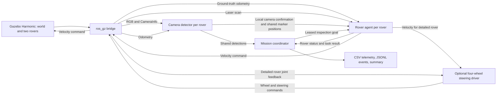

# Architecture

## Processes and interfaces

Two instances each of `rover_agent` and `target_detector` run under `/rover1` and
`/rover2`. Topics for the shared mission are global. All mission positions use
the `world` frame. Gazebo's OdometryPublisher provides world poses directly;
this is ground-truth localisation, not wheel-odometry SLAM.

| Topic or service | Type | Role |
| --- | --- | --- |
| `/clock` | `rosgraph_msgs/Clock` | Simulation time |
| `/roverN/cmd_vel` | `geometry_msgs/Twist` | ROS to Gazebo command |
| `/roverN/odom` | `nav_msgs/Odometry` | Gazebo ground-truth pose |
| `/roverN/camera/image` | `sensor_msgs/Image` | Actual rendered image |
| `/roverN/camera/info` | `sensor_msgs/CameraInfo` | Pinhole camera calibration |
| `/roverN/scan` | `sensor_msgs/LaserScan` | Forward safety range sensor |
| `/roverN/plan` | `nav_msgs/Path` | Collision-checked planned route |
| `/roverN/navigation_state` | `std_msgs/String` | Driving, turning, surveying, passing or stop reason |
| `/mission/detections` | `rsdis_interfaces/Detection` | Shared target IDs and estimated world positions |
| `/mission/status` | `rsdis_interfaces/RoverStatus` | Pose, battery, mode, travelled distance and consumed energy |
| `/mission/goals` | `rsdis_interfaces/TaskGoal` | Target, owner and renewable task lease |
| `/mission/results` | `rsdis_interfaces/TaskResult` | Completion or release reason |
| `/mission/return_home` | `std_msgs/Bool` | Latched instruction to return and remain parked |
| `/mission/finished` | `std_msgs/Bool` | Latched final stop |
| `/mission/set_paused` | `std_srvs/SetBool` | Pause/resume rover commands and task deadlines |
| `/mission/recall` | `std_srvs/Trigger` | End exploration and return both rovers |
| `/roverN/set_enabled` | `std_srvs/SetBool` | Controlled failure injection and recovery |
| `/roverN/joints/WHEEL/velocity` | `std_msgs/Float64` | Detailed model only: wheel angular velocity |
| `/roverN/joints/WHEEL/steering` | `std_msgs/Float64` | Detailed model only: steering angle |
| `/roverN/joint_states` | `sensor_msgs/JointState` | Detailed model only: actual joint feedback |

## Perception

Five distinct colour IDs identify five spherical markers. HSV segmentation and
contour shape reject small, clipped or strongly non-circular blobs. Approximate
forward range is `fx * marker_diameter / bounding_box_width`. Horizontal pixel
offset gives lateral position. The camera offset and closest timestamped world
pose transform this into a shared world coordinate.

This is a known-size marker method, not recognition of real lunar minerals.
It assumes a mostly level rover and limited roll/pitch, and uses an approximation
to a sphere's projected diameter. It must be evaluated against target truth
separately from coordination. Images more than 0.2 s from a stored pose are
discarded. An inspection requires facing the marker and observing it locally
for a dwell period; a teammate's detection alone cannot confirm it.

## Allocation

Both policies reject a task if the predicted travel to the target, an estimated
return leg, idle time and a reserve exceed the available battery. The nearest
policy minimises travel distance. The energy policy minimises:

`score = distance_to_inspection + risk_weight * required_battery / available_battery`

The fixed `risk_weight` has distance units. This is a heuristic to compare in
experiments; it is not claimed to be optimal or to always beat the baseline.
Allocation considers one task at a time, in a deterministic target-ID order.
Actual A* detours can exceed the straight-line energy estimate. The local agent
also checks its return budget and can release a task before depletion.

Target IDs suppress duplicate records. Only one owner is active per target and
one inspection is assigned to a rover at a time. Leases are renewed at 2 Hz.
Lost status, an unavailable/returning rover or a task timeout releases ownership.
Each target has at most three attempts, with a cooldown; failed missions remain
in the results. Task IDs change on reassignment and delayed results are ignored.

## Control and energy

Agents alternate between exploration, inspection, return, charging, parked,
unavailable and depleted states. A bounded planar A* plans around mapped terrain
hazards, camera-derived marker positions and last-known peer poses. Circular
obstacle radii are inflated by the rover radius plus a safety margin. Every edge
is checked in continuous coordinates; the controller aligns before translation
and checks a sampled curved sweep over reaction and braking time. Facing rovers
commit to a right-side passing point to break symmetric route oscillation.

A front-mounted 180-degree, 721-ray laser runs at 10 Hz. Valid scan points are
projected using rover pose and sensor extrinsics, with eight seconds of local
obstacle memory. Peer returns do not leave trails in this memory. Missing or
invalid scans stop commands. Scientific target coordinates are never preloaded
into agents; only terrain hazards are a known prior map. Survey stops sweep the
camera once, and inspection approaches stay fixed rather than moving around the
marker as the rover turns. See `NAVIGATION.md` for limits and regressions.

The loopback web console is a ROS node with a local HTTP server. Incoming
operator requests enter a queue and call the existing ROS services from the ROS
executor. It displays observed sites, actual camera frames and planned/travelled
paths. It does not substitute target truth for camera data. Pause preserves task
leases and extends deadlines; recall resumes a paused mission, cancels inspections
and finishes with `operator_returned` once both rovers park.

Battery decreases with measured distance and simulation time. Recharging happens
at a base with an accelerated synthetic rate. Lunar solar shadowing is not yet
coupled to these values. The source defaults intentionally differ between rovers
to exercise different energy conditions. All parameters are saved with each run.

## Offline rehearsal boundary

The portable program imports exactly the same `Coordinator` and `Rover` classes.
It integrates planar velocity commands without wheel contact or collision
physics and injects perfect detections within a range/FOV window. Synthetic
range endpoints exercise the same obstacle gate; an independent truth-based
geometry audit records footprint gaps and overlaps. Its playback
is a diagnostic view and must never be presented as a Gazebo demo or a detector
benchmark. The actual ROS detector never reads target positions from configuration.
